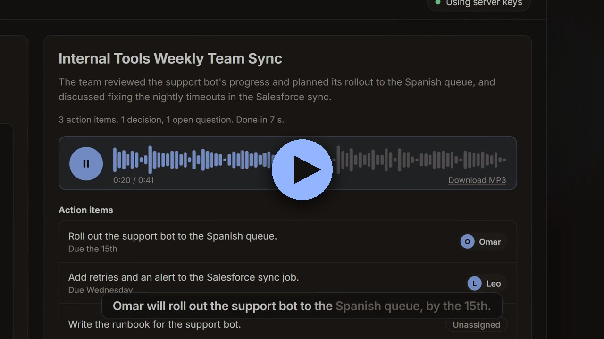

# meeting-briefer

[](https://github.com/Smartulf123/meeting-briefer/actions/workflows/ci.yml)

Give it a meeting recording or the notes from one. ElevenLabs Scribe turns the recording into a transcript, Claude pulls out the decisions, action items and owners as validated JSON, and ElevenLabs reads a short briefing aloud.

<a href="https://smartulf123.github.io/meeting-briefer/"></a>

**Click to watch the 30-second demo** (with sound). The briefing voice in it is the app's real ElevenLabs output. The narrator is a local AI voice, and I made the video with Cutscene, my own AI video tool.

**Demo, text in:** [demo/output/briefing.mp3](demo/output/briefing.mp3) (41 seconds), made from [demo/standup.txt](demo/standup.txt). The JSON it produced is in [demo/output/summary.json](demo/output/summary.json).

**Demo, audio in:** [demo/standup-recording.mp3](demo/standup-recording.mp3) is a 37-second, three-person meeting. [demo/from-recording](demo/from-recording) holds what came out: the [transcript](demo/from-recording/transcript.txt) with speaker labels, the [JSON](demo/from-recording/summary.json) and the [spoken briefing](demo/from-recording/briefing.mp3). The recording isn't a real meeting. I made it from the same notes with three ElevenLabs voices ([scripts/make_test_recording.py](scripts/make_test_recording.py)), so the audio path can be tested without recording anyone.

I built this as a small portfolio project. The goal was to practise the parts that matter when you put an LLM into an internal workflow: structured output you can trust, a way to measure quality, an API other tools can call, and careful handling of keys.

## What it does

```
recording ──> ElevenLabs Scribe ──┐
                                  ▼
notes ──────────────────────> transcript ──> Claude (structured output) ──> checks ──> briefing script ──> ElevenLabs TTS ──> briefing.mp3
                                                  ^                            │                                             summary.json
                                                  └──── retry with feedback ───┘
```

0. **Transcribe (recordings only).** Scribe (`scribe_v2`) turns the audio into text and marks who is speaking, giving lines like `Speaker 2: I'll have it live by the 15th.` Claude only swaps a label for a real name when the conversation makes it clear. In the demo, "Omar, you own the rollout?" answered by Speaker 2 makes Speaker 2 Omar. Leo is never named, so his task stays with "Speaker 3" and his name isn't guessed.
1. **Extract.** `messages.parse` with a Pydantic model returns JSON that matches the `MeetingSummary` schema: title, summary, decisions, action items (task, owner, due) and open questions.
2. **Check.** The schema can't say "the owner must be someone in this meeting", so the code checks that every owner appears in the transcript and that no task is listed twice. If a check fails, it asks Claude again and tells it what was wrong (up to 3 attempts). A truncated answer is also retried, and a refusal is reported, not retried.
3. **Write the briefing.** A plain template turns the JSON into short spoken sentences ("Omar will roll out the support bot, by the 15th."). There is no second LLM call, so the audio can only say what the checked JSON says.
4. **Speak.** The ElevenLabs Python SDK turns the script into an MP3 with the `eleven_flash_v2_5` model.

You can use it three ways:

- **Web page** at `http://127.0.0.1:8000`. Paste your own Anthropic and ElevenLabs keys and a transcript, or upload a recording, then get the action items, decisions and an audio player.
- **API:** `POST /briefings` with `{"transcript": "...", "audio": true}`. Keys can come from the `X-Anthropic-Api-Key` and `X-ElevenLabs-Api-Key` headers (bring your own key) or from the server's `.env`. If `WEBHOOK_SECRET` is set, the request must carry an `X-Timestamp` (Unix seconds) and an `X-Signature: sha256=<HMAC of "timestamp.body">` header, like Slack's signing. Requests older than 5 minutes are refused, so a captured request can't be replayed later. Only `Content-Type: application/json` is accepted, which stops another website from posting to a server running on your machine and spending its keys.
- **Recording upload:** `POST /briefings/audio?filename=meeting.mp3` with the raw audio as the body and `Content-Type: audio/mpeg` (or another `audio/*` type), up to 25 MB. The audio goes up as the raw body rather than a form, because a browser must ask the server first before sending an `audio/*` body from another website. The same keys and signature headers apply.
- **CLI:** `meeting-briefer notes.txt` or `meeting-briefer recording.mp3`, with `[--no-audio] [--out folder]`.

## Eval results

Eight hand-written meetings live in [evals/cases](evals/cases), each with an `expected.json`. They test the cases that trip up summarizers: a task handed from one person to another, tasks nobody owns, a brainstorm with no decisions or actions, notes in bullet form, and a messy Slack export. [evals/run_evals.py](evals/run_evals.py) scores each run:

- an expected action item counts as matched when one of its keywords appears in a predicted task **and** the owner is the same person (or both are unassigned);
- precision catches extra items, recall catches missed ones, and owner accuracy is counted separately.

| Run | Action precision | Action recall | Owner accuracy | Decision recall | Decision precision | Cost for 8 meetings* |
|---|---|---|---|---|---|---|
| Opus 5.5, medium effort, first prompt | 0.91 | 1.00 | 1.00 | 1.00 | 0.71 | about $0.09 |
| Opus 5.5, low effort | 0.90 | 0.90 | 1.00 | 1.00 | 0.77 | about $0.09 |
| **Opus 5.5, medium effort (default)** | **0.91** | **1.00** | **1.00** | **1.00** | **0.71** | **about $0.09** |
| Haiku 5.5, medium effort | 0.95 | 0.90 | 1.00 | 1.00 | 1.00 | about $0.003 |

\*From the token counts in [evals/results](evals/results) and Anthropic's list prices. Every case finished on the first attempt.

What I learned from these runs:

- **The first run found a real bug.** In the feedback meeting, Claude listed "No decision on dark mode" as a decision. I added one line to the prompt (an undecided topic belongs under open questions), and it now lands there. The decision-precision number didn't move, because in the same meeting Claude now lists "flag the Excel issue" as a decision, which my expected answer doesn't count.
- **Low effort is not free.** At low effort, Opus dropped the two "someone should..." tasks in the unowned-tasks meeting. Haiku dropped the same two. Medium effort catches them, so medium is the default.
- **Some "mistakes" are my expectations being strict.** Most of the extra items are defensible. Examples: "check with infra about capping beta signups" as an unowned task, or Henrik saying "good, do that, Jonas", which approves the monitoring work. I left the expected answers as they were instead of tuning them to the model's output, so the numbers stay honest.
- **Haiku is a realistic option.** It made no extra decisions and costs about a thirtieth of Opus. If missing unowned tasks were acceptable, it would be the cheaper choice.

Re-score saved results without API calls: `python evals/run_evals.py --replay evals/results/claude-opus-5-5.medium.json`.

## Setup

Requires Python 3.11+.

```bash
git clone https://github.com/Smartulf123/meeting-briefer.git
cd meeting-briefer
python -m venv .venv
.venv/Scripts/pip install -e ".[dev]"      # macOS/Linux: .venv/bin/pip
cp .env.example .env                        # then paste your keys into .env
python scripts/check_setup.py              # checks both keys, makes no audio
```

- Anthropic key: [console.anthropic.com](https://console.anthropic.com/settings/keys)
- ElevenLabs key: [elevenlabs.io](https://elevenlabs.io/app/settings/api-keys) (the free plan is enough), or run `npx @elevenlabs/cli onboard init` to sign in and save one to `.env`.

Run it:

```bash
uvicorn meeting_briefer.api:app             # web page on http://127.0.0.1:8000
meeting-briefer demo/standup.txt            # or from the command line
meeting-briefer demo/standup-recording.mp3  # a recording works too
python evals/run_evals.py                   # eval set
pytest                                      # 34 tests, no API calls (fake clients)
```

## Handling secrets

- Keys live in `.env`, which is git-ignored. Only `.env.example` with empty values is committed.
- Keys sent by a caller in headers are used for that one request, are never written to disk, and never appear in logs. The logs only record whether caller keys were used.
- Settings are read with `pydantic-settings`, and keys are stored as `SecretStr`, so printing the settings doesn't show them.
- The test suite builds its settings with `_env_file=None`, so the tests never touch real keys.

## Logging

Each step writes one `key=value` line: extraction attempt, model, seconds, input and output tokens, how many items were found and how many checks failed; the TTS model, characters and seconds; for recordings, the Scribe model, audio length and number of speakers; the run id and output folder. That's enough to see cost and latency per run and to grep for retries.

## Limitations

- **The eval set is small and written by me.** Eight short, clean meetings say little about a 60-minute call with crosstalk. Keyword matching is crude: it can't tell a good paraphrase from a lucky word match.
- **Recordings are only tested on a generated meeting.** The demo recording uses three clean studio voices with pauses between turns. Real meetings have crosstalk, background noise and people who never say their names, so expect more "Speaker 3" owners. The eval set only covers text.
- **The owner check is shallow.** It only checks that the owner's first name appears in the transcript, not that this person actually took the task.
- **English only,** and the briefing template is fixed, so long meetings make long briefings.
- **No real Slack app.** The webhook is generic and signed. A Slack slash command would need Slack's own signature format and a background job, because Slack expects a reply within 3 seconds.
- **Replay protection is time-based only.** A signed request can be resent within its 5-minute window. A production version would also remember recent signatures or delivery ids.
- **Runs synchronously.** A request takes about 5 to 10 seconds. A real deployment would put the work on a queue.
- **Audio is stored on local disk,** and anyone with the 12-character run id can fetch it. Bring-your-own-key should only be used over HTTPS or on localhost.
- **ElevenLabs free plan:** about 10,000 characters a month, no commercial use, and published audio should credit ElevenLabs. The briefing voice is George, and the test meeting uses Sarah, Chris and Charlie, all premade ElevenLabs voices. Audio generated with [elevenlabs.io](https://elevenlabs.io).

## How I chose the stack

Before building, I ran my own [check-before-you-build](docs/check-before-you-build/report.md) skill on the idea. It looks for existing projects and recommends a stack. It found that meeting summarizers are common: Otter, Fireflies and Zoom do it commercially, and the closest open-source project, MoM AI, uses ElevenLabs only for speech-to-text. None of the projects it found read a briefing aloud or measured extraction quality with an eval set, so those became the focus. I later added Scribe transcription as well, so the project takes audio in and gives audio out. The report was written while the plan still included Norwegian, which I later dropped to keep the project English only.

Stack: Python, [Anthropic SDK](https://github.com/anthropics/anthropic-sdk-python), [ElevenLabs SDK](https://github.com/elevenlabs/elevenlabs-python), [FastAPI](https://github.com/fastapi/fastapi), [pydantic-settings](https://github.com/pydantic/pydantic-settings), [pytest](https://github.com/pytest-dev/pytest). I built it with Claude Code.

## Layout

```
src/meeting_briefer/
  models.py     Pydantic schema (MeetingSummary, ActionItem)
  extract.py    Claude call, transcript checks, retry loop
  briefing.py   JSON -> spoken script
  stt.py        ElevenLabs Scribe speech-to-text with speaker labels
  tts.py        ElevenLabs text-to-speech
  pipeline.py   recording or transcript -> transcript.txt, summary.json, briefing.txt, briefing.mp3
  api.py        FastAPI app, signed webhook, recording upload, bring-your-own-key
  static/       the web page
  scoring.py    eval matching and metrics
evals/          cases, runner, saved results
scripts/        check_setup.py, send_webhook.py, make_test_recording.py
tests/          unit and API tests with fake clients
.github/        CI: lint and tests on Python 3.11 and 3.12 for every push
```

## License

MIT
